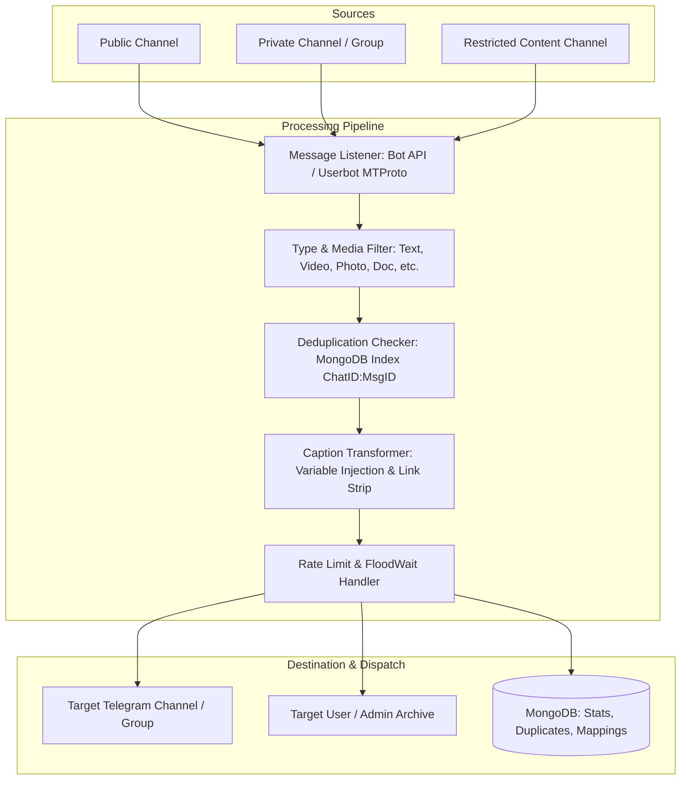

# 🚀 Telegram Forward Bot Engine

[](https://www.python.org/)
[](https://docs.pyrogram.org/)
[](https://motor.readthedocs.io/)
[](https://cryptography.io/)
[](Dockerfile)
[](LICENSE)
[](https://github.com/psf/black)

A high-performance, asynchronous Telegram message relay and channel forwarding engine built with **Pyrogram**, **TgCrypto**, and **MongoDB Motor**.

Features hybrid routing (Bot API with automatic fallback to encrypted user MTProto sessions for private/restricted channels), intelligent deduplication, dynamic caption transformation, granular media filtering, and an interactive in-chat Control Center UI.

---

## 📌 Table of Contents

- [Key Architecture & Data Flow](#-key-architecture--data-flow)
- [Core Features](#-core-features)
- [Interactive Control Center (In-Chat UI)](#-interactive-control-center-in-chat-ui)
- [Dynamic Caption Engine](#-dynamic-caption-engine)
- [Project Structure](#-project-structure)
- [Getting Started](#-getting-started)
  - [Prerequisites](#prerequisites)
  - [Local Installation](#local-installation)
  - [Configuration (`.env`)](#configuration-env)
- [Docker Deployment](#-docker-deployment)
- [Environment Variables Reference](#-environment-variables-reference)
- [Security & Encryption](#-security--encryption)
- [License](#-license)

---

## 🏗️ Key Architecture & Data Flow



---

## ⚡ Core Features

- **🔄 Hybrid Forwarding (Bot API + User MTProto Fallback)**:
  - Forwards standard public channels via Bot API (`copy_message`).
  - Seamlessly falls back to an authenticated MTProto User session when targeting private, invite-only, or bot-restricted channels.

- **🛡️ Persistent Deduplication Engine**:
  - Automatically records and verifies unique `source_id:message_id` hashes in MongoDB.
  - Prevents duplicate reposts even across restarts, network interruptions, or backlog replays.

- **🎨 Dynamic Caption Transformation Engine**:
  - Customizable caption templates supporting variables like `{caption}`, `{source}`, `{date}`, `{time}`, `{views}`, and `{message_id}`.
  - Automatic promotional content stripping: removes external URLs, `@mentions`, and `#hashtags` with regex-based sanitation.

- **🎯 Granular Multi-Type Filtering**:
  - Independently toggle forwarding for **11 distinct message types**:
    `text`, `photo`, `video`, `document`, `audio`, `voice`, `animation` (GIF), `sticker`, `video_note`, and `other`.
  - Configurable per-channel or globally.

- **📜 History Catch-Up & Batch Forwarding**:
  - Ingest and forward message history from any starting message link or ID.
  - Configurable skip points (`skip_until`) so future catch-up jobs start cleanly from the latest forwarded ID.

- **🔐 Enterprise-Grade Session Encryption**:
  - Sensitive user session strings are encrypted using **Fernet AES-128/256-CBC** cryptography before storage in MongoDB.
  - Protects user authentication tokens against database dump compromises.

- **📊 Comprehensive Analytics & Stats**:
  - Real-time global and per-mapping analytics tracking total messages forwarded, filtered items, duplicates blocked, and error rates.

---

## 🎮 Interactive Control Center (In-Chat UI)

Admins can manage the entire forwarding infrastructure directly through Telegram inline keyboards without touching the command line:

```text
╔═══════════════════════════════════════════════╗
║         🎛️ FORWARD BOT CONTROL CENTER         ║
╠═══════════════════════════════════════════════╣
║  Active Mappings: 4                           ║
║  Total Messages Forwarded: 12,450             ║
║  Status: 🟢 Running                           ║
╠═══════════════════════════════════════════════╣
║  [ ➕ Add Mapping ]     [ 📋 List Rules ]     ║
║  [ 🎨 Edit Caption ]    [ 🎯 Filter Types ]   ║
║  [ ⏩ Set Skip Point ]  [ 🔐 Manage Session ] ║
║  [ 📊 Global Stats ]    [ 🔄 Refresh State ]  ║
╚═══════════════════════════════════════════════╝
```

### Supported Commands:
- `/start` - Opens the interactive Control Center dashboard.
- `/stats` - Displays global performance metrics and throughput.
- `/help` - Displays full syntax and parameter references.
- `/cancel` - Resets current interactive configuration state.

---

## 📝 Dynamic Caption Engine

Define custom caption templates per mapping. The template engine automatically substitutes live metadata:

### Available Variables:
| Variable | Description | Example Replacement |
|:---|:---|:---|
| `{caption}` | Original message text or media caption | `Breaking news update...` |
| `{clean_caption}` | Original caption with links and @mentions removed | `Breaking news update` |
| `{source}` | Source channel title or username | `Tech Insider News` |
| `{date}` | Current UTC date (`YYYY-MM-DD`) | `2026-09-29` |
| `{time}` | Current UTC time (`HH:MM:SS`) | `14:30:00` |
| `{views}` | Message view counter | `1,420` |
| `{message_id}` | Source message ID | `4821` |

### Example Template:
```text
📢 {clean_caption}

---
📡 Source: {source} | 📅 {date}
```

---

## 📂 Project Structure

```text
forward-bot/
├── .env.example             # Standard environment variable configuration template
├── .gitignore               # Strict exclusion rules for sessions, secrets, and caches
├── docker-compose.yml       # Docker Compose service definition (Bot + MongoDB)
├── Dockerfile               # Multi-stage production container build
├── forward_bot.py           # Core asynchronous bot engine and MTProto router
├── LICENSE                  # MIT License
├── README.md                # Comprehensive documentation
├── requirements.txt         # Production Python dependencies
└── SETUP_GUIDE.md           # Step-by-step setup walkthrough and troubleshooting
```

---

## 🛠️ Getting Started

### Prerequisites

1. **Python 3.11+** installed.
2. **MongoDB** instance (Local MongoDB or free [MongoDB Atlas](https://www.mongodb.com/atlas) cloud cluster).
3. **Telegram API Credentials**:
   - `API_ID` & `API_HASH` from [my.telegram.org](https://my.telegram.org) (under *API Development Tools*).
   - `BOT_TOKEN` from [@BotFather](https://t.me/BotFather) on Telegram.
   - `ADMIN_ID` (your personal Telegram user ID, obtain from [@userinfobot](https://t.me/userinfobot)).

### Local Installation

1. **Clone the repository:**
   ```bash
   git clone https://github.com/YOUR_USERNAME/forward-bot.git
   cd forward-bot
   ```

2. **Create and activate a virtual environment:**
   ```bash
   # macOS/Linux
   python3 -m venv .venv
   source .venv/bin/activate

   # Windows (PowerShell)
   python -m venv .venv
   .\.venv\Scripts\Activate.ps1
   ```

3. **Install dependencies:**
   ```bash
   pip install --upgrade pip
   pip install -r requirements.txt
   ```

4. **Configure environment variables:**
   ```bash
   cp .env.example .env
   ```
   *Edit `.env` and fill in your Telegram API credentials, Admin ID, and MongoDB connection string.*

5. **Run the bot:**
   ```bash
   python forward_bot.py
   ```

---

## 🐳 Docker Deployment

The fastest way to deploy the bot along with an isolated MongoDB database:

1. **Configure `.env`**:
   Ensure `.env` exists with your credentials. Set `MONGO_URI`:
   ```bash
   MONGO_URI=mongodb://mongodb:27017/forward_engine
   ```

2. **Start with Docker Compose**:
   ```bash
   docker compose up -d --build
   ```

3. **Check logs**:
   ```bash
   docker compose logs -f bot
   ```

4. **Stop the container**:
   ```bash
   docker compose down
   ```

---

## ⚙️ Environment Variables Reference

| Variable | Required | Description | Example |
|:---|:---:|:---|:---|
| `API_ID` | **Yes** | Telegram App API ID from `my.telegram.org` | `12345678` |
| `API_HASH` | **Yes** | Telegram App API Hash from `my.telegram.org` | `abcdef1234567890abcdef1234567890` |
| `BOT_TOKEN` | **Yes** | Telegram Bot Token from `@BotFather` | `1234567890:ABCdefGHIjklMNOpqrsTUVwxyz` |
| `ADMIN_ID` | **Yes** | Telegram User ID of the primary administrator | `987654321` |
| `MONGO_URI` | **Yes** | MongoDB connection string (Local or Cloud Atlas) | `mongodb://localhost:27017/forward_engine` |
| `SECRET_KEY` | **Yes** | Fernet 32-character key for session string encryption | `xQ8W3vR9pK2mN5bH7jL0sF4dG6aT1eY8cZ3xV5nM2qW=` |
| `WEBHOOK_URL` | Optional | Webhook endpoint for Discord/Slack error alerts | `https://discord.com/api/webhooks/...` |

### How to Generate `SECRET_KEY`:
Run this one-liner in Python:
```bash
python -c "from cryptography.fernet import Fernet; print(Fernet.generate_key().decode())"
```

---

## 🔒 Security & Encryption

- **Zero-Secret Exposure**: No credentials, session tokens, or API secrets are stored in the repository.
- **Session Encryption**: When adding a userbot session for private channel access, the session string is symmetrically encrypted using Fernet before being written to MongoDB.
- **Strict Access Control**: All bot commands, callback queries, and state mutations are restricted strictly to `ADMIN_ID`. Unauthorized users receive zero response.
- **Git Guardian**: `.gitignore` strictly blocks all Telegram session files (`*.session`, `*.session-journal`) from accidental commits.

---

## 📄 License

This project is licensed under the [MIT License](LICENSE).
